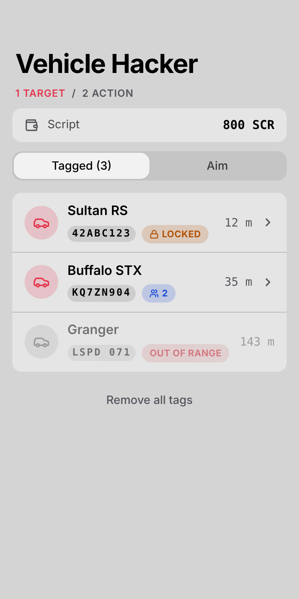
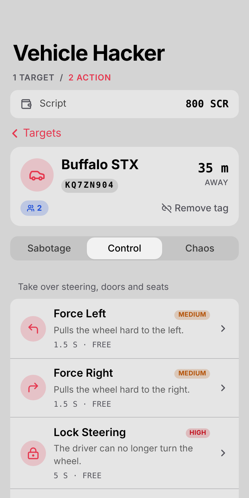
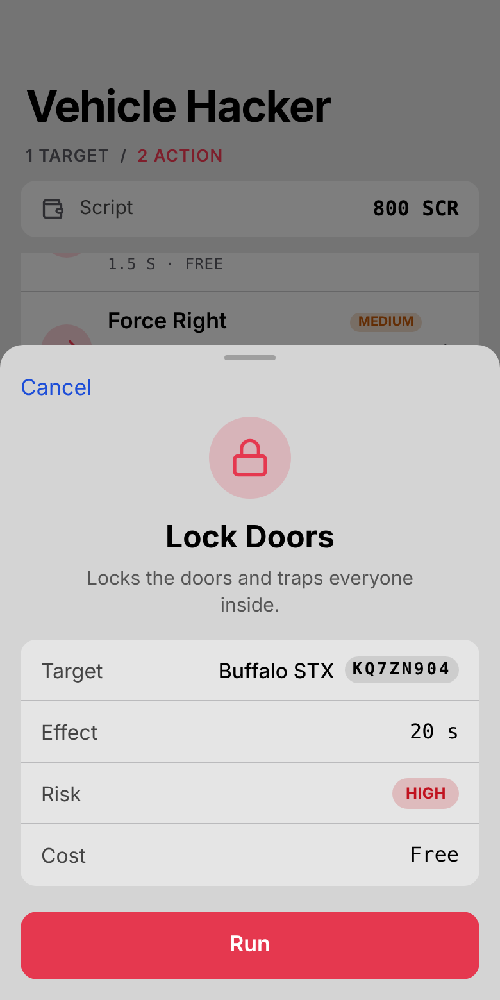
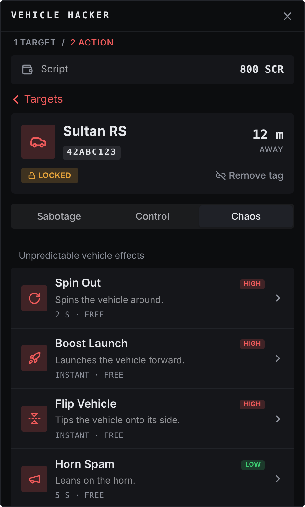

# ghm-vehiclehack

Remote vehicle sabotage, control and chaos, run from the player's phone.

Vehicle Hacker is an app for [sd-phone](https://github.com/Samuels-Development) (or, if you do not run sd-phone, a
standalone screen). A player links to a vehicle, picks one of sixteen actions and the server makes it happen: kill the
engine, burst the tires, lock the doors with everyone inside, flip it, rig it to explode when it slows down.

| | |
| --- | --- |
|  |  |
|  |  |

## Features

- **Two steps, easy to follow.** Pick a target, then pick an action. A confirmation sheet shows what an action does,
  how long it lasts, its risk, its price and the player's balance before it runs.
- **Two ways to pick a target.**
  - *Tagged*: stick a Vehicle Tag on a vehicle, then choose it from a list (model, plate, distance, who is inside,
    locked or not) for as long as it stays in range.
  - *Aim*: open the phone's camera, point it at a vehicle and press the shutter. The phone stays open and unlocked.
    (Without a phone camera the screen is put away and a crosshair is shown instead.)
- **Sixteen actions in three tabs.** Sabotage, Control and Chaos. Every name, description, duration, risk and price is
  in `config.lua`, and any action can be left out.
- **Earned, not given.** In sd-phone the app is hidden until the player uses a `vehicle_hacker_unlock_usb` once. The
  phone spends it and installs the app on that character for good.
- **Optional prices, in any money type.** Free by default. Turn free mode off and every action charges cash, bank,
  crypto or any other money type (or account) your framework has, on the server, and refunds it if the action could
  not run. The app always shows the player's balance of that one currency.
- **Server authoritative.** The player's client never decides what happens (see [How it is protected](#how-it-is-protected)).
- **Works on qbx_core, QBCore and ESX.** Light and dark themes follow the phone. Translatable.

## Requirements

| Needed | For |
| --- | --- |
| A FiveM server with **OneSync** | server-side vehicle and ped lookups |
| [`ox_lib`](https://github.com/overextended/ox_lib) | callbacks, notifications, progress bar, locales |
| An inventory: [`ox_inventory`](https://github.com/overextended/ox_inventory), qs-inventory(-pro), tgiann-inventory, jaksam_inventory, origen_inventory, codem-inventory, one_inventory, qb-inventory, ps-inventory, lj-inventory, or ESX's own | the three items (see [Inventories](#inventories)) |
| One of `qbx_core`, `qb-core`, `es_extended` | money and the character identifier |
| [`sd-phone`](https://github.com/Samuels-Development) | the phone app (skip it for standalone mode) |

sd-phone needs the custom app features this resource uses: `addCustomApp` with `requires`, the `unlockApp` /
`hasAppUnlock` exports and, for aiming with the phone camera, `useCamera` / `sendCameraMessage`. It was written against
sd-phone 1.0.6. On an sd-phone without `useCamera` aiming falls back to the crosshair.

## Installation

1. Download the `ghm-vehiclehack-<version>.zip` from the [latest release](https://github.com/lGodHatesMel/ghm-vehiclehack/releases/latest)
   and put the `ghm-vehiclehack` folder in your `resources` folder. The UI is already built in the zip. If you clone the
   repo instead, you need to build the UI first (see [Changing the UI](#changing-the-ui)).
2. Add the items to your inventory (below).
3. Start it after its dependencies in `server.cfg`:

   ```cfg
   ensure ox_lib
   ensure ox_inventory    # or whichever inventory you use
   ensure qbx_core        # or qb-core / es_extended
   ensure sd-phone        # not needed for standalone mode
   ensure ghm-vehiclehack
   ```

4. Open `config.lua` and read it once from the top. The defaults work as they are (sd-phone, free, both targeting modes).
5. Give players the items however you like (a shop, crafting, a job reward, `/giveitem`).

### Fuel scripts

Fuel Leak drains the tank through `bridge/fuel.lua`, so the fuel script does not top it up again behind the effect.
`Config.Fuel = 'auto'` uses the first started one of `ox_fuel`, `LegacyFuel`, `cdn-fuel`, `ps-fuel`, `lj-fuel`, `okokFuel`,
`stg-vanaheimfuel`. Name one to force it, or `'none'` to change only the GTA fuel level. ox_fuel is read and written
through its `fuel` state bag; the others through their `GetFuel` / `SetFuel` exports. A script that is not in the list
still gets its gauge drained, but may refill it; add it to `SUPPORTED` in `bridge/fuel.lua`.

### Items

Add the ones you use. **`consume = 0` is on purpose**: this resource removes the item itself, only after the thing it is
for has actually happened, so a failed attempt never costs the player the item.

```lua
-- Installs the app on the character's phone (Config.UseSdPhone = true). Spent on use.
['vehicle_hacker_unlock_usb'] = {
    label = 'Vehicle Hacker USB',
    weight = 100,
    stack = false,
    close = true,
    consume = 0,
    description = 'A USB drive containing a vehicle hacking application.',
    server = { export = 'ghm-vehiclehack.useUnlockItem' },
},

-- Tags the nearest vehicle (Config.Targeting.Tagged). One is spent per vehicle tagged.
['vehicle_tag'] = {
    label = 'Vehicle Tag Device',
    weight = 200,
    stack = true,
    close = true,
    consume = 0,
    description = 'Tags a nearby vehicle for remote hacking.',
    server = { export = 'ghm-vehiclehack.useTagItem' },
},

-- Opens the standalone screen (Config.UseSdPhone = false). Not spent: it has to stay in the inventory.
['vehicle_hacker_device'] = {
    label = 'Vehicle Hacker Device',
    weight = 500,
    stack = false,
    close = true,
    consume = 0,
    description = 'A handheld device used to hack nearby vehicles.',
    server = { export = 'ghm-vehiclehack.useStandaloneItem' },
},
```

The item names are set in `config.lua` (`Config.UnlockItem`, `Config.TagItem`, `Config.StandaloneItem`) if you want
different ones.

### Inventories

`bridge/inventory.lua` is all this resource knows about inventories: how many of an item a player holds, taking one
away, and making an item usable. `Config.Inventory = 'auto'` uses the first of these that is started, in this order:
`one_inventory`, `ox_inventory`, `tgiann-inventory`, `jaksam_inventory`, `qs-inventory-pro`, `qs-inventory`,
`origen_inventory`, `codem-inventory`, `qb-inventory`, `ps-inventory`, `lj-inventory`. Set it to a resource name to force
one. With none of them (or one the bridge does not know) the framework's own item calls are used, which is how
qb-inventory, ps-inventory, lj-inventory and ESX's built-in inventory work. Everything else (images, stashes, metadata) is
the inventory's own business.

How the items are made usable depends on the inventory:

| Inventory | Item definition | Usable handler |
| --- | --- | --- |
| ox_inventory | the block above, with `server = { export = ... }` and `consume = 0` | the export named in the item |
| qb-inventory / ps / lj / qbx (`shared/items.lua`) | `{ name = 'vehicle_tag', label = 'Vehicle Tag Device', weight = 200, type = 'item', image = 'vehicle_tag.png', unique = false, useable = true, shouldClose = true, description = '...' }` | registered by this resource at start |
| ESX (`items` table) | `INSERT INTO items (name, label, weight) VALUES ('vehicle_tag', 'Vehicle Tag Device', 1);` | registered by this resource at start |
| qs / tgiann / jaksam / origen / codem / one | the inventory's own item file, as a normal usable item | registered by this resource at start |

On every inventory except ox the item only has to **exist** and be usable; there is no `server.export` to set. This
resource registers the handlers and spends the item itself, so do not give the item a `consume`/`remove on use` flag. If
your inventory has none of the registration paths (the console prints `could not make "..." usable`), use the item
through your inventory's own usable-item hook and call `exports['ghm-vehiclehack']:useTagItem` from it; the other two
exports are `useUnlockItem` and `useStandaloneItem`. Their arguments are `('usingItem', nil, { id = source })`.

## How players use it

1. **Install.** Use the `vehicle_hacker_unlock_usb`. The *Hacker* app appears on the phone, for good.
2. **Pick a target.** Open the app.
   - *Tagged*: stand within a few metres of a vehicle and use a `vehicle_tag`. After the animation the vehicle is on the
     list (within `Config.ScanRadius`).
   - *Aim*: tap *Start aiming*. The phone camera opens; point it at a vehicle and press the shutter.
3. **Pick an action.** Choose a tab, tap an action, check the sheet and press *Run*.

A bar under the tabs drains during the cooldown, and a timed effect shows a live countdown on its row.

### The actions

| Tab | Action | Effect |
| --- | --- | --- |
| Sabotage | Kill Engine | Shuts the engine down for good |
| | Lock Brakes | Forces the handbrake on |
| | Disable Brakes | The driver's brake and handbrake stop responding |
| | Burst Tires | Blows out the tires |
| | Fuel Leak | Drains the tank until it is empty |
| Control | Force Left / Force Right | Pulls the wheel hard to one side |
| | Lock Steering | The driver can no longer turn the wheel |
| | Force Doors | Unlocks the vehicle and swings every door open |
| | Eject Occupants | Throws everyone out |
| | Lock Doors | Locks the doors and traps everyone inside |
| Chaos | Spin Out | Spins the vehicle around |
| | Boost Launch | Launches it forward |
| | Flip Vehicle | Tips it onto its side |
| | Horn Spam | Leans on the horn |
| | Speed Bomb | Explodes the vehicle when its speed drops under a threshold |

Steering and brake actions act on a *player* driver by taking that player's input on their own client. A
computer-controlled driver does not read player controls, so Lock Steering and Disable Brakes do nothing to one; Force
Left / Right do steer an NPC driver.

## Configuration

Everything is in `config.lua`, with a comment on every option. The ones you will touch first:

| Option | Default | |
| --- | --- | --- |
| `Config.UseSdPhone` | `true` | `true`: an sd-phone app. `false`: a standalone screen opened with `Config.StandaloneItem` |
| `Config.DefaultApp` | `false` | `true` installs the app on every phone, no unlock item |
| `Config.Targeting.Tagged` / `.Aim` | `true` / `true` | Turn a way of picking a target off |
| `Config.ScanRadius` | `100.0` | A target must be this close (metres) when an action runs |
| `Config.Cooldown` | `2000` | Milliseconds between two actions from one player |
| `Config.FreeMode` | `true` | `false` charges `cost` (per action) in `Config.Currency` |
| `Config.Currency` | `{ Type = 'cash' }` | The money type actions are paid in, and how it is shown (see [Currency](#currency)) |
| `Config.ProtectedModels` | `{}` | Vehicles nobody can hack, e.g. `{ 'police', 'ambulance' }` |
| `Config.Categories` / `Config.Actions` | | Tabs, names, descriptions, durations, risk and price of every action |
| `Config.SpeedBomb` | | Threshold (in `Config.SpeedUnit`), arm delay and the longest a bomb stays armed |
| `Config.Aim`, `Config.Tag` | | Aim range, how long a tag takes, how many a player can keep, whether a tag is spent |

### Currency

Actions are paid in **one framework money type**, set by `Config.Currency.Type`. There is no crypto system in this
resource or in the frameworks: `crypto` and `script` are simply money types a framework may have, like `cash` and
`bank`.

| Framework | What `Type` can be |
| --- | --- |
| qbx_core | A key of `config.money.moneyTypes` in qbx_core's server config (`cash`, `bank`, `crypto`, `script` by default, plus any you added) |
| QBCore | A key of `Config.Money.MoneyTypes` in qb-core's config (`cash`, `bank`, `crypto` by default, plus any you added) |
| ESX | `cash` (the money account), `bank`, or the name of an account you created (ESX has no crypto account unless you add one) |

```lua
Config.Currency = {
    Type = 'script',   -- the money type
    Label = nil,       -- name shown in the app; made from the type when left out ("script" -> Script)
    Symbol = nil,      -- short form next to an amount; "$" for cash and bank, otherwise the first three letters
                       -- of one word or the initials of several ("script" -> SCR, "maze coin" -> MC)
    SymbolFirst = nil, -- true "$150", false "150 SCR" (cash and bank default to true)
    Decimals = 0,      -- places shown and kept; action costs are rounded to this
}
```

A wallet row under the app's title shows the player's balance of that currency, with its name, whether or not free
mode is on. If the framework does not have the money type (a typo, or it was never added), the row shows a dash and, with
free mode off, every action is refused instead of being run for free. The prices are the `cost` of each action in
`Config.Actions`.

### Standalone mode

Set `Config.UseSdPhone = false` and use the `vehicle_hacker_device` item. The same app opens as a flat panel in the
middle of the screen (Escape closes it). The device has to stay in the player's inventory while they use it. Aiming
puts the panel away for a crosshair (click to lock on, Backspace to cancel) and brings it back.

### Languages

Text follows ox_lib's language setting (`setr ox:locale "en"` in `server.cfg`) and falls back to English. To add a
language copy `locales/en.json` to `locales/<code>.json` and translate the values; no rebuild is needed. The action names
and descriptions are edited in `config.lua`.

## How it is protected

A client can send anything, so the client is never asked to decide anything.

- The app sends one thing: *run this action on that vehicle*. Prices, durations and results are looked up by the server.
- A vehicle can only be hacked if it is one of that player's own targets (a tag they placed, or something they aimed at
  in the last `Config.Aim.Window`), it belongs to the character that made it, it still exists, it is within
  `Config.ScanRadius` of the player's ped, it is not in `Config.ProtectedModels` and it is not the vehicle the player is
  sitting in.
- One action per `Config.Cooldown`, per player, checked on the server.
- The server checks that the player has the app (the sd-phone unlock, or the device in their inventory) on **every**
  request, because hiding an icon authorises nothing.
- With free mode off, the server reads the balance and takes the money before anything happens, and gives it back if
  nobody could carry the action out.
- Tagging is timed by the server: it cannot land before `Config.Tag.Duration` has passed, the player has to be within
  `Config.Tag.Range`, and the tag item is removed by the server only when it lands.
- The effect itself is pushed to the **owner** of the vehicle (the only client that can change it) and to the players
  sitting in it, resolved on the server from the seats. The player who pressed the button does not run anything.
- The Speed Bomb is watched on the server, so a vehicle changing owner cannot lose it.

## For developers

### Exports (server)

```lua
exports['ghm-vehiclehack']:isTagged(source, netId)  -- does this player have that vehicle tagged?
exports['ghm-vehiclehack']:clearTargets(source)     -- drop everything a player has linked
```

`useUnlockItem`, `useTagItem` and `useStandaloneItem` are the item handlers from the items above.

### Changing the UI

The app is React + Tailwind in `ui/`. The game loads the built files in `ui/dist`. That folder is not in the repo; it is
generated, and the release zips already contain it.

```bash
cd ui
npm install
npm run dev      # http://localhost:5173, with a mock of the game
npm run build    # writes ui/dist, which the game loads
```

### Making a release

Publish a GitHub Release with a new tag (for example `v2.0.1`). GitHub Actions (`.github/workflows/release.yml`) builds
the UI and attaches `ghm-vehiclehack-<tag>.zip` to that release.

In the dev server `?mode=standalone` previews the standalone panel, and the address bar picks a scenario:
`#default`, `#paid`, `#empty`, `#aimonly`, `#taggedonly`, `#offline`. To work on it inside the game, point `ui_page` in
`fxmanifest.lua` at the dev server (the line is there, commented out).

## Troubleshooting

- **The icon does not show up.** The character has not used the `vehicle_hacker_unlock_usb` yet. `/appunlock grant
  ghm-vehiclehack` (sd-phone) installs it by hand. Make sure `ghm-vehiclehack` started *after* `sd-phone`, or restart it.
- **Using the USB does nothing.** On ox_inventory the item must have `server = { export =
  'ghm-vehiclehack.useUnlockItem' }` and `consume = 0`, and ox_inventory must have been restarted after editing it. On
  any other inventory the item must exist and be usable, and `ghm-vehiclehack` must have started *after* the framework
  (check the console for `could not make ... usable`). With `Config.Debug = true` the console says which inventory was
  detected; if `auto` picked the wrong one, name it in `Config.Inventory`.
- **The item is used but never removed (or removed twice).** The inventory is consuming it as well. Turn off its own
  consume / remove-on-use for these three items.
- **"Nothing happens" in the app.** The server refused the request because the character does not have the app. See the
  first point.
- **An action does nothing to a vehicle.** It needs the vehicle to exist on a client (the owner is told to change it) and
  to be within range. Another resource that also controls the vehicle's locks or fuel can fight an effect.
- **Aiming puts the phone away and the lock screen comes back.** Your sd-phone does not have `useCamera`, so the crosshair
  is used. Update sd-phone.
- **The wallet shows `--`, or every action is refused with "The payment account is unavailable".** `Config.Currency.Type` is not a money type your framework has for that player. Check it against your core's money types (see [Currency](#currency)).
- **Costs are charged in the wrong account.** Check `Config.Currency.Type`.

## Upgrading from 1.x

- The three item entries changed (see [Items](#items)): handlers are server exports and `consume` is `0`.
- Removed: the `/untag`, `/checktags` and `/cleartags` commands (the app lists and removes tags) and the `vh_*` debug
  commands. Exports `tagVehicle`, `untagVehicle` and the client `isTagged` are gone; `isTagged(source, netId)` is now a
  server export.
- `Config.TargetingMode` became `Config.Targeting.Tagged` / `.Aim` (both can be on), `Config.Raycast` became `Config.Aim`,
  `Config.HackCooldown` became `Config.Cooldown`, `Config.CurrencyType` became `Config.Currency.Type` (with `Label`, `Symbol`, `SymbolFirst` and `Decimals` beside it), and `Config.TagRange` / `Config.TagDuration` moved into `Config.Tag`.
- Action durations in `Config.Actions` are now the durations that actually run.
- sd-phone's own `configs/apps.lua` needs nothing for this app.

## License

[MIT](LICENSE) - use it, change it, sell it, as long as the copyright and license notice stay with it.
